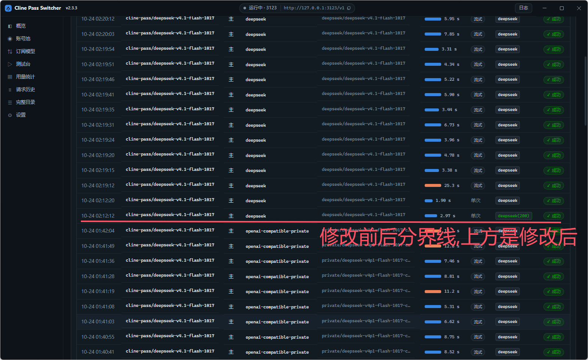

# cline-pass-switcher-desktop-upgrade-1024 —— 桌面版

[中文](README.md) · [English](README.en.md)

把 Cline Pass 的**上游观察 / 切换代理**装进一个桌面程序：有窗口、有托盘、有开机自启，
不用开终端、不用敲命令。

## 本次更新（v2.4.0）

这一版围绕「让钉住真正生效」做了几件事：

- **能力过滤 `has`**：规划器管道上，单独的 `providerOptions.gateway.only` 会被服务端虚拟模型配置覆盖；
  同时带上 `gateway.has`（如 `vision`、`implicit-caching`）后，`only` 才会被真正执行。
  渠道编辑弹窗新增了**两组请求的对照验证**：A 组必须命中目标上游，B 组的无效上游必须被拒绝。
- **探测不到渠道也能钉**：「订阅模型 → 渠道」不再要求先有渠道清单，可直接手动填写 `deepseek`
  等上游 slug；能不能钉住以验证结果为准。
- **探测兜底**：枚举渠道时如果发现无效 `only` 被忽略，会自动带上 `has` 再探一次，
  这样 `deepseek-v4.1-flash-1017` 这类模型也能正常列出可用渠道。
- **人民币计价补全**：`deepseek-v4.1-flash-1017` 快照按 `deepseek-flash` 官方价目表计算。
- **更安全的仓库**：新增 `npm run check:secrets`，并补上了本地运行数据的 `.gitignore` 规则。
- **改名与版本**：应用名改为 `cline-pass-switcher-desktop-upgrade-1024`，版本 `2.4.0`；
  数据目录仍沿用旧名，升级不会丢账号、密钥和用量历史。

### 实际效果

下面是真实的请求历史对比（红线以上为修改后）：请求体带上 `providerOptions.gateway.has` 后，
`only: ["deepseek"]` 真正生效，实际渠道从 `openai-compatible-private` 变成 `deepseek`。



> 能力过滤 `has` 的思路与 2026-10-23 的实测结论来自 LINUX DO 的这篇实测帖：
> [linux.do/t/topic/3064863](https://linux.do/t/topic/3064863)。感谢原帖作者的实测与整理。
> 下文「让钉住真正生效」一节记录了完整机制和验证方法。

## 界面

**概览** —— 代理状态、客户端接入地址、账号额度：


**用量统计** —— 趋势、人民币花费、逐条明细，随请求实时更新：


> 截图用演示数据，账号名与密钥已替换。

## 它解决什么问题

Cline Pass 订阅模型（`cline-pass/*`）请求体里的 `provider.*` 会被网关**丢掉**，改由网关自己挑上游。
于是「我到底被路由到哪个上游、能不能固定住、固定的那个还活着吗」——光看客户端是看不出来的。

| 能力 | 说明 |
|---|---|
| 管道识别 | 探测模型走 `direct`（OpenRouter）还是 `planner`（Vercel AI Gateway） |
| 渠道枚举 | 从一次极小额真实请求的响应元数据里读出可用上游清单 |
| 有序钉住 | 每个模型配一条钉住链，按序尝试、异常自动顺切；另有排除列表 |
| 能力过滤 | 给规划器管道加 `gateway.has`，让 `only` 真正被执行（否则网关会忽略钉住） |
| 钉住校验 | 链上每个渠道各钉一次，实测可用性并落盘成状态 |
| 账号池 | 多账号轮询或手动指定，含官方额度（5 小时 / 本周 / 本月） |
| 请求历史 | 每条请求实际命中的上游、背后模型、耗时、命中账号 |
| 用量统计 | Token / 缓存 / 花费趋势（当天按小时、7/31/60/90 天）与明细，实时更新 |
| 人民币计价 | DeepSeek 按官方价目表计费（含峰谷），与美元账单**并列不合并** |
| 双协议 | 同时提供 `/v1/chat/completions` 与 `/v1/messages`，Claude Code 可直连 |
| 写入 Claude Code 配置 | 一键写进 `~/.claude/settings.json`（只动自己的键、写前备份、可还原） |
| 中英双语 | 跟随系统语言，也可在设置里指定 |

## 快速开始

**装**：从 [Releases](https://github.com/lnsane/cline-pass-switcher-desktop/releases) 下载
`cline-pass-switcher-desktop-upgrade-1024-Setup-<版本>.exe`（安装版）或
`-Portable-<版本>.exe`（免安装单文件）。
首次启动到「账号池」添加 Cline Pass 的 API Key（`sk_` 开头）并保存即可用。

> 安装包**未签名**。Windows 开了 Smart App Control 会拦安装版 —— 改用免安装版即可。

**源码跑**：

```bash
npm install
npm run dev          # 起窗口
```

**本地构建**（比打包快，也不受签名限制）：

```bat
scripts\build-win.bat        :: Windows，可双击
```
```bash
bash scripts/build-mac.sh    # macOS
```

都支持 `--clean`（先删 `dist/`）、`--run`（构建完直接启动）。
注意：脚本只能构建**本平台**产物，要出另一平台的包请推 tag 让 CI 打。

## 客户端接入

| 客户端 | 填什么 |
|---|---|
| OpenAI 兼容 | Base URL `http://127.0.0.1:3199/v1` |
| Claude Code | `ANTHROPIC_BASE_URL=http://127.0.0.1:3199` |

模型名照抄 `cline-pass/xxx`。两种协议都支持工具调用与流式。

## 让钉住真正生效：能力过滤 `has`

Cline Pass 的规划器管道上，**只发** `providerOptions.gateway.only` 是不生效的：服务端的虚拟模型
配置会覆盖客户端的路由限制 —— 实测连一个不存在的上游都能成功返回。2026-10-23 对两把 key 的
实测发现：同一请求里再加上能力过滤 `providerOptions.gateway.has` 后，`only` 才真正被执行
（无效上游被拒绝，响应里的 `finalProvider` 变成被钉住的上游）。

本程序的处理：

- **探测不到渠道也能钉**：「订阅模型 → 渠道」不再要求先有渠道清单，直接用「手动添加渠道」
  填 `deepseek`（或任意上游 slug）即可；加入后照常点测试 / 验证，能不能钉住以验证结果为准。
- 每个模型可单独配置能力标签（「订阅模型 → 渠道 → 能力过滤」）。默认只对
  **规划器 + 只钉 `deepseek` + 多模态模型（v4.1-flash / vision）** 自动开启
  `vision` + `implicit-caching`（那次实测的模型正是这一类）。纯文本模型（如 v4-pro）默认不动：
  给它加 `vision` 会一个上游都匹配不到，而只加 `implicit-caching` 是否也能让 `only` 生效没有实测证据
  —— 可在渠道编辑里试，先点两组请求验证再保存。其它模型同样默认关闭：能力过滤会把不满足条件的
  渠道全部排除，没验证过就默认开启可能直接没有可用上游。
- 规划器管道上已钉住但没启用能力过滤的模型，列表里会标「钉住可能被忽略」——这就是
  单独 `only` 不生效的那一类。
- 请求体顶层是 `{ "providerOptions": { "gateway": { "only": [...], "has": [...] } } }`。
  直连（OpenRouter）管道不发送 `has`，它本来就能透传 `provider.only`。
- 「校验全部渠道」会带上当前配置的 `has`，所以校验结果反映真实可钉性，而不是「看似都可用」。
- 渠道编辑弹窗里的 **验证钉住是否生效（两组请求）** 会复刻实测的对照：A 组带
  `only=[链首]` + `has`，必须命中链首；B 组把 `only` 换成 `not-a-real-provider`，必须被拒绝。
  两组同时成立才算「已生效」。
- 升级提示：如果之前已经钉住 `deepseek` 且是多模态模型，启动时会自动补上这组能力过滤
  （写回 `config.json`），不用重新配置；纯文本模型保持原样，列表里会提示「钉住可能被忽略」。
  想关掉的话在渠道编辑里取消勾选即可。

> 这是**实测结论，不是文档承诺**：具体内部机制没有服务端源码可查，不同 key / 模型 / 时间都可能
> 变化。换 key、换模型后请重新点一次上面的验证，别只看最终回答。

## 用量统计

数据有**两个来源**，按请求 id 去重后合并 —— 所以**不开代理也能统计**：

| 来源 | 花费 |
|---|---|
| 经本机代理的请求 | **上游网关的真实账单** |
| 扫 Claude Code 会话记录补的 | 定价表估算（标「估」） |

DeepSeek 系列另按**官方人民币价目表**计价（元/百万 token）：

| 模型 | 缓存命中 | 未命中 | 输出 |
|---|---|---|---|
| `deepseek-flash` | 0.02 / 0.04 | 1 / 2 | 4 / 8 |
| `deepseek-v4-pro` | 0.15 / 0.30 | 4.5 / 9.0 | 13.5 / 27.0 |

每格是「空闲 / 高峰」。高峰为北京时间周一至周五（不含法定节假日）9:00-12:00、14:00-18:00，
其余时段空闲，**空闲价恰为高峰的一半**。

两点必须说清楚：

- **两个币种不合并**。人民币来自官方价目表、与渠道无关；美元是上游真实账单。
  相加或按汇率折算都会得到一个含汇率假设的假数字，所以各计各的。
- 只有 DeepSeek 有官方人民币价，其他模型（k3 / glm / qwen 等）保持「无人民币价」，
  不拿别的价格顶成 ¥0。

> 老数据显示 ¥0 是正常的 —— 人民币计价是后加的能力。点明细区的**「重算人民币」**
> 按官方价目表重推全部历史即可补上（幂等，点几次都一样）。

## 写入 Claude Code 配置

「概览 → 客户端接入」和「设置 → 数据」里都有这个按钮，把本机代理写进 `~/.claude/settings.json`：

- 只动它自己负责的键，其余原样保留；写前自动备份，可一键还原
- 上下文窗口可选 **200K（默认）/ 1M**。选 1M 写 `CLAUDE_CODE_MAX_CONTEXT_TOKENS=1000000`；
  换回 200K 会**真的把这个键删掉**（合并式写入删不掉键，不显式删就会「看着改了其实没改」）
- 写超时重算：上游拒绝超过其实际能力的窗口，界面上会拿探测到的真实窗口校验你的选择
- 写完需重启 Claude Code（或新开会话）才生效

## 测试

```bash
npm run test:unit          # 协议翻译状态机
npm run test:has           # 能力过滤：only+has 注入、两组对照、配置迁移
npm run test:usage         # 用量统计核心
npm run test:cny           # DeepSeek 人民币计价（含跨时区校验）
npm run test:usage-offline # 用量端到端（纯离线）
npm run test:claudecfg     # 配置写入 / 备份 / 还原
npm run test:context       # 上下文窗口档位
npm run test:i18n          # 双语覆盖
```

要真实账号密钥的（`test:live` / `test:e2e` / `test:usage-live`）**不进 CI**，
本地用 `BASE=` `KEY=` 指定目标手动跑。

## 已知边界

- **端口冲突**：默认 `3123`，与命令行版相同。同时跑两个要改端口。引擎**绝不杀**占用端口的进程，
  只会报 `EADDRINUSE` 让你换一个。
- **未签名**：Windows Smart App Control 会拦安装版（用免安装版），macOS 首次打开被 Gatekeeper 拦
  （右键 → 打开，或 `xattr -cr`）。
- **只监听 `127.0.0.1`**：不对局域网开放，要给别的设备用需自加反向代理。

## 许可

MIT。
